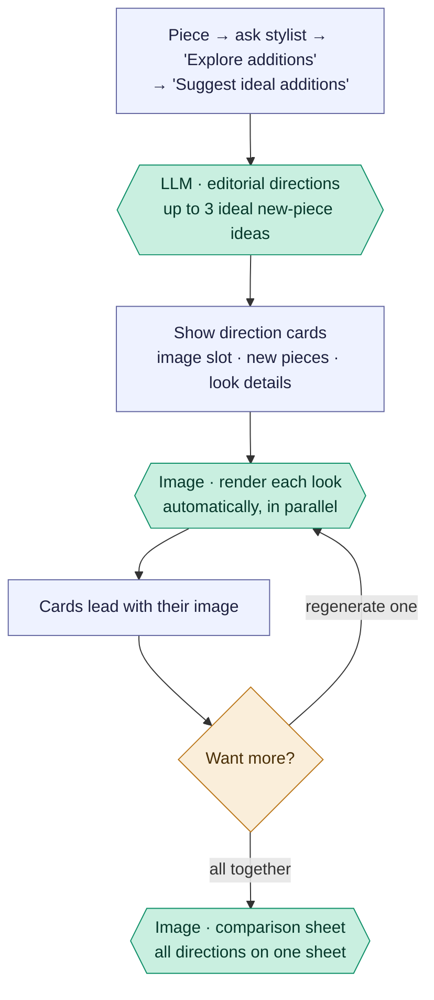

# Editorial ideal additions — "shop the gap"

From a selected garment, this suggests **ideal *new* pieces** to buy — things you
don't own that would elevate the item — then optionally renders them as editorial
images. Unlike the composition flows (which only use owned pieces), this one is
deliberately aspirational. It's a **preview → render** pipeline: one text-model
call produces up to three directions, and you can then render one look, or render
all of them onto a single comparison sheet.

Reading convention (see [use-my-wardrobe.md](use-my-wardrobe.md)): rectangles are
the app's own code, `LLM ·` hexagons are the text model, `Image ·` hexagons are
the image model (GPT-4o), diamonds are decisions.

> **Routing note.** The piece panel's **"Explore additions"** toggle (submit
> button: **"Suggest ideal additions"**) lands *here* — not in the
> [selected-piece composer](selected-piece-composer.md)'s ideal branch, which is
> reachable only via free-typed wording. See the routing note there.

## Overview (PM altitude)

Three takeaways for a PM:

- **This is the only flow that invents pieces you don't own.** Every other flow
  composes from the wardrobe; here the text model is explicitly told to propose
  *conceptual missing pieces* (and not to re-suggest things you already have).
- **One text call, then every look renders automatically.** **[owner ruling 2026-10-20]** As soon
  as the directions arrive, each card's image renders (all of them in parallel, one image call per
  direction), and the card leads with the image; the sketch, summary and full-look text fold under
  **Look details**. This supersedes the earlier "cost is opt-in" ruling for this flow. Renders fire
  only for a reply created in the current page session, never on a reload. The comparison sheet is
  still an extra, on-request render.
- **The renders are conditional GPT-4o.** Both image steps fall back to a local
  collage / placeholder when `PHOTO_PRESERVING_VISUALS` is on or there's no API key
  — the same pattern as [saved-outfit variants](saved-outfit-variants.md).

## The three endpoints

| Step | Endpoint | Model |
| --- | --- | --- |
| Directions preview | `/editorial-directions-preview` | text (Claude) |
| Render one look | `/editorial-render-one` | image (GPT-4o, conditional) |
| Comparison sheet | `/generate-ideal-additions-preview-sheet` | image (GPT-4o, conditional) |

### Stage map

| Stage | What happens | Where |
| --- | --- | --- |
| A | Select a piece → ask stylist → **"Explore additions"** toggle → **"Suggest ideal additions"** (`StylistChat.jsx:4697`/`:4977`); also a board → "Explore ideal additions", or free-typed editorial phrasing | `StylistChat.jsx:3256` (`shouldGenerateEditorialVisuals`), `:3021` |
| P | Generate up to 3 directions | `routes/ai.js:3256` → `askStylist(EDITORIAL_NEW_PIECES_SYSTEM)` |
| D | Render direction cards | frontend |
| E | Render one direction | `routes/ai.js:3353` → `createEditorialConceptImage` (`core.js:3224`) |
| S | Render all as a sheet | `routes/ai.js:3067` → `createIdealAdditionsComparisonSheetImage` (`core.js:2447`) |

## Engineer notes

- **Directions are text, with a local fallback.** `askStylist` with
  `EDITORIAL_NEW_PIECES_SYSTEM` returns `{ directions: [...] }` — each has a title,
  `missingPieces`, `pieceNotes` (one description per new piece: fabric and weight, cut and fit,
  defining detail, what it does for the anchor — added 2026-10-19 at owner request), reason,
  watchFor, and a `visualPrompt`. The card lists the new pieces with their descriptions. If the model returns
  none, `buildIdealOnlyCompletionsForPiece` fills locally. Results are run through
  `dedupeAndDifferentiateEditorialDirections` and capped at 3 (`ai.js:3320`).
- **Anchor + anti-duplication.** The selected garment stays central
  (`idealAdditionAnchorConstraint`), and the prompt forbids suggesting pieces that
  replace the anchor or duplicate wardrobe basics you already own (`ai.js:3308`).
  Afterwards `dedupeAndDifferentiateEditorialDirections` rewrites a suggestion only when it
  replaces the anchor's role, repeats within the set, or **nearly matches an owned piece by name**
  (`ownedNearlyMatchesArchetype`). **[owner ruling 2026-10-19]** The earlier color + category
  family match (`ownedLooksSimilarToArchetype`) rewrote 9 of 11 distinct model suggestions on a
  289-piece wardrobe (thread_1792476353706), so the card listed stock pool pieces while the render
  followed the model's own `visualPrompt`. That coarse match now only picks stock pool pieces. A
  rewritten piece loses its `pieceNotes` entry, since the note described a different garment.
- **Follow-up questions about a suggested piece (2026-10-20).** A chat follow-up such as "tell me
  more about the tee in Ink Navy Contrast" often routes to `/ask`'s compact `garment_fact` path,
  which answers only from garment records. Suggested pieces have none, so it used to reply that no
  such garment existed (thread_1792476353706). `compactFreeformContext` now also returns
  `suggestedCards` (card title, suggested pieces with their `pieceNotes` descriptions, full look)
  from the thread's cards, and `compactFreeformAnswerMessage` adds them, labelled as unowned
  suggestions, for `garment_fact` and `existing_card_explanation`. Text only: the rendered image
  is not attached (owner choice, descriptions first). The system prompt is unchanged.
- **[owner ruling 2026-10-20] The model is not sent the owned wardrobe.** `EDITORIAL_NEW_PIECES_SYSTEM`
  mentions "the owned inventory list", but the route never sends one; `ownedRows` feeds only the
  post-hoc check above. So a suggestion can sit close to something owned (thread_1792485547849:
  a deep olive wide-leg utility trouser beside owned olive utility/cargo pants, a cognac slide beside
  owned cognac strap sandals). The owner accepts that; do not re-propose sending the wardrobe.
- **Seed look (taste DNA).** If a rendered wardrobe board is passed as `seedLook`,
  its image + piece list are fed in as the "visual and styling DNA" to push the
  ideal additions beyond that saved look (`ai.js:3287`).
- **Both renders are conditional** (`createEditorialConceptImage`, `core.js:3224`;
  `createIdealAdditionsComparisonSheetImage`, `core.js:2447`): GPT-4o
  `image_generation` by default; `photoPreservingVisualsEnabled()` → local collage;
  no `OPENAI_API_KEY` → a `sharp` placeholder / error. `render-one` renders a single
  direction; the sheet renders all directions with the garment as the one shared
  reference photo.
- **Related but distinct** from the selected-piece composer's "ideal" branch
  (which composes *outfit* directions mixing owned + missing pieces). This flow is
  the pure *new-pieces* editorial one — `shouldGenerateEditorialVisuals` vs
  `shouldGenerateOutfits` picks between them on the frontend (`StylistChat.jsx:3256`).
