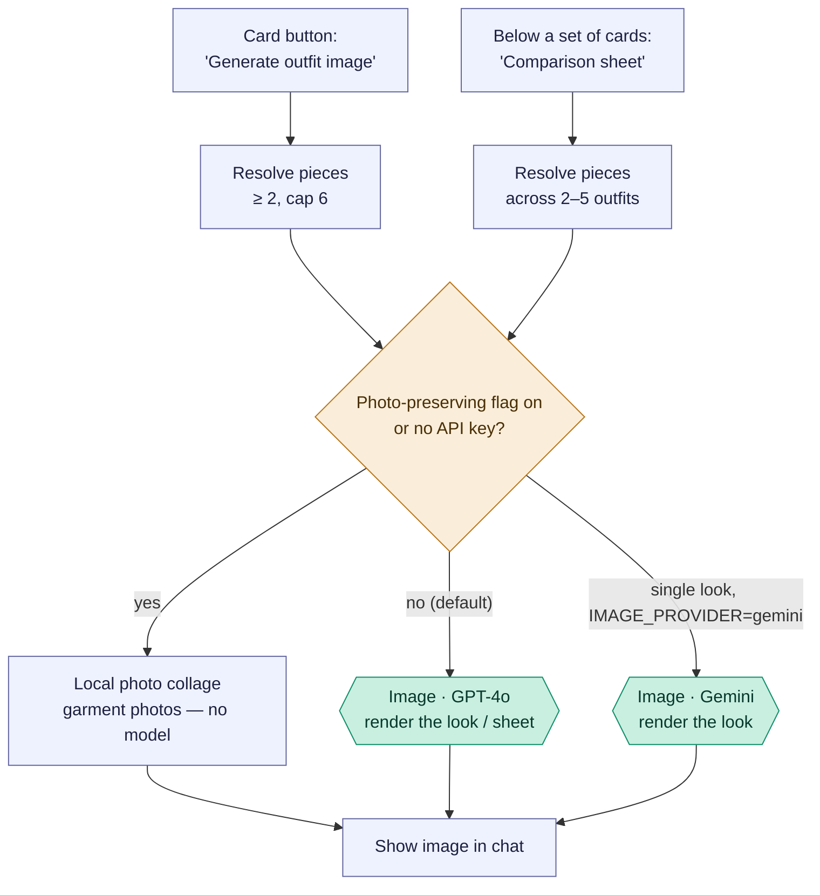

# Outfit image renders — "Generate image" & "Comparison sheet"

Two ways to turn outfit *cards* into a rendered image: **Generate outfit image**
(one full look) on a single card, and **Comparison sheet** (several looks side by
side) below a set of cards. Both are the same conditional pattern as the other
image flows — GPT-4o by default, a local photo collage as fallback.

Reading convention (see [use-my-wardrobe.md](use-my-wardrobe.md)): rectangles are
the app's own code, `Image ·` hexagons are the image model (GPT-4o), diamonds are
decisions.

## Overview (PM altitude)

Takeaways:

- **Two entry points, one render pattern.** A single card renders **one full-outfit
  look**; the sheet renders **2–5 outfits on one contact sheet** for quick
  comparison. Different render function, same conditional-GPT-4o structure.
- **Conditional model, like the rest.** Both fall back to a local collage (no
  model) when `PHOTO_PRESERVING_VISUALS` is on or there's no API key — same as
  [saved-outfit variants](saved-outfit-variants.md).
- **These sit on top of the composition flows.** The cards come from
  [Use my wardrobe](use-my-wardrobe.md), freeform chat, etc.; rendering is an
  opt-in action layered on any outfit card.

## The two endpoints

| Action | Endpoint | Renders |
| --- | --- | --- |
| Generate outfit image | `/generate-wardrobe-outfit-image` | one full-outfit look |
| Comparison sheet | `/generate-wardrobe-outfit-comparison-sheet` | 2–5 outfits on one sheet |

### Stage map

| Stage | What happens | Where |
| --- | --- | --- |
| A | "Generate outfit image" on a card | `StylistChat.jsx:2807` → `POST /api/ai/generate-wardrobe-outfit-image` (`routes/ai.js:2990`) |
| C | "Comparison sheet" below a set | `StylistChat.jsx:2857` → `POST /api/ai/generate-wardrobe-outfit-comparison-sheet` (`routes/ai.js:3021`) |
| B/D | Resolve pieces from the outfit(s) | ≥ 2 pieces required |
| E/F/G | Render | `createWholeWardrobeOutfitImage` (`core.js:2199`) / `createWholeWardrobeComparisonSheetImage` (`core.js:2289`) |

Engineer notes:

- **Single render** (`createWholeWardrobeOutfitImage`, `core.js:2199`): up to 6
  pieces; GPT-4o `image_generation` fed the garment reference photos, or a
  `createPhotoPreservingCollageImage` collage when the flag/key dictates.
  **Amended 2026-10-18:** with `IMAGE_PROVIDER=gemini` and a Gemini key, the
  single render instead makes one call to Google's image model
  (`renderWithGeminiImageModel`, `styling-engine/geminiImage.js`; default
  `gemini-nano-banana-2.1`, 2:3 at 2K). It receives the same photos, captions
  and prompt in the same order, with no gpt-4o rewrite step in between. Off by
  default; the sheet and the other image flows stay on GPT-4o.
  **Amended 2026-10-24:** the OpenAI single render no longer goes through GPT-4o.
  It calls the Images API edit endpoint (`runOpenAIImageEditFromContentParts`)
  with the same photos and the prompt verbatim, each photo marked `[Image N]`
  where it sat. Cost is estimated from OpenAI's reported usage at the published
  flare rates (`estimateOpenAIImageCostUsd`). See engine-behaviour-map.md,
  "The producers". The sheet stays on GPT-4o.
  **Amended 2026-10-26 (length tag owns hem position):** owner ruling — a length
  tag alone must be enough for a correct render (thread_1793066674849). Photo
  captions now hand hem position to the recorded length when a top or outerwear
  piece has one (`garmentReferencePlan`), and the construction line states the
  length as a visible body cue (`styling-engine/lengthCues.js`). *Tried and removed
  the same day:* a cheap vision check of each render's hem plus one targeted
  "lengthen this garment" edit. The check read the owner's own worn photos (the
  true length) as short on both Gemini Flash-Lite tiers, so it could not decide
  when to edit; the edit itself moved the hem only about an inch.
  **Same day, from a full capture of the request:** (1) on a see-through piece
  (`semi_sheer`/`sheer`/`open_weave`, `pieceIsSeeThrough`) the construction line
  states the recorded neckline as the *front* neckline instead of "exactly as in
  the reference photo" — a scoop-neck tunic's V back showed through its front in
  the hanger photo and every render drew a V-neck; the tagger is told the same
  (`SEE_THROUGH_NECKLINE_INSTRUCTION`). (2) The fidelity checklist takes sleeves
  from `sleeve_length` and skirt-vs-pants from `bottom_subtype` when recorded,
  not from words in name/notes ("short-sleeve" in a note overrode an elbow tag;
  "knee" in a pants note produced "must remain the listed skirt shape"). (3) Each
  render prompt states that a recorded fact beats a disagreeing note
  (`RENDER_NOTES_RULE`).
- **Sheet render** (`createWholeWardrobeComparisonSheetImage`, `core.js:2289`):
  takes 2–5 normalized outfits (each ≥ 2 saved pieces, deduped, capped at 6
  pieces; ≤ 30 distinct pieces total), and lays them out as one preview sheet —
  explicitly labelled "use individual Generate outfit image buttons for final
  renders." Same conditional path.
- Both return a `board` with an `imageUrl`; the frontend renders it inline in the
  chat thread.
